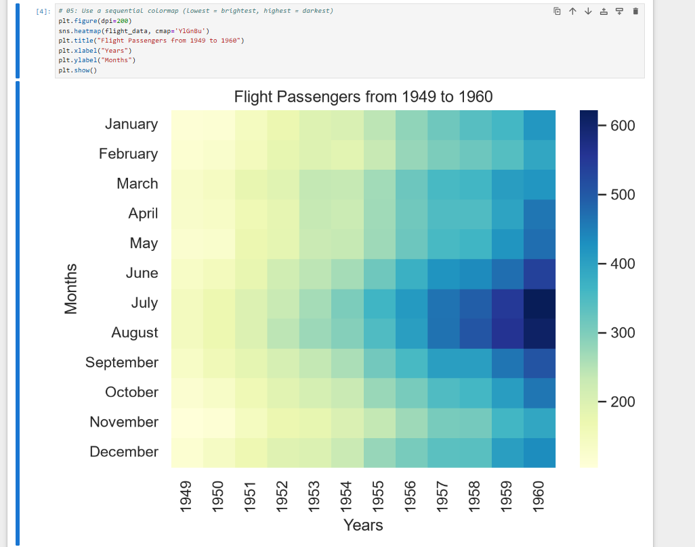

# My Data Science Portfolio
## About Me
I am a master student majoring in Data Science and Marketing Analytics. I focus on data cleaning, exploratory analysis and data visualization using Python.

## Project Showcase
### Project Title: Flight Details Exploratory Data Analysis
**Research question**: What are the distribution characteristics of flight data, and what relationships exist between flight attributes?

This heatmap shows the number of flight passengers across months and years from 1949 to 1960. It reveals passenger volume rises in summer months and grows steadily over the decades.

Project repository: https://github.com/chakkailin/data-science-project
Current project status: completed
